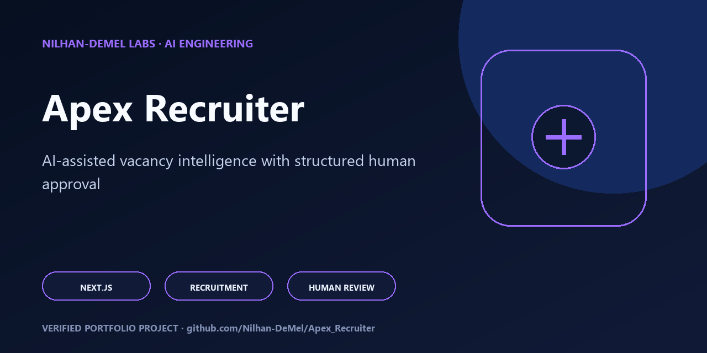

# Apex Recruiter

<!-- portfolio-flagship -->
<p align="center"></p>

> **Portfolio review path:** Start with the capabilities and architecture below, then reproduce the documented verification commands. See [SECURITY.md](SECURITY.md), [CONTRIBUTING.md](CONTRIBUTING.md), and [RIGHTS.md](RIGHTS.md) for the project's operating and reuse boundaries.

An AI-assisted vacancy-intelligence workspace for turning incomplete hiring context into structured, reviewable candidate scenarios.

Apex Recruiter is a polished Next.js prototype that combines a streaming recruitment chat with a live context workspace. Recruiters can gather vacancy notes, links, and text files; guide an AI through role calibration; compare versioned candidate-persona structures; approve individual scenarios; and export review material from one interface.

## Engineering highlights

- **Purpose-built conversation design:** the system prompt drives role summary, requirements, seniority, logistics, dealbreakers, and Sri Lankan market context rather than offering a generic chat box.
- **Streaming client:** incremental Server-Sent Event parsing updates the active assistant message token by token.
- **Typed vacancy state:** Zustand models messages, files, notes, extracted text, persona versions, approvals, salary hypotheses, risks, outreach angles, and Boolean searches.
- **Context workspace:** drag-and-drop ingestion, link and note management, extracted-text inspection, and responsive tabbed views.
- **Human approval:** persona cards distinguish safe, stretch, high-potential, budget, fast-joiner, and niche-specialist scenarios, with explicit approval state.
- **Export surfaces:** print-ready PDF flow, machine-readable JSON, and an editable document prototype.
- **Modern frontend:** Next.js 16, React 19, TypeScript, Tailwind CSS, Radix primitives, Motion, and responsive split-pane design.

## Current architecture

```text
Recruiter input + vacancy context
             |
             v
Client-side Zustand workspace
       |                 |
       v                 v
Streaming OpenAI chat   Persona review/export surfaces
```

The current implementation is intentionally local to the browser tab. Text files are read client-side; other file types expose the upload/review UX but still use placeholder extraction. The OpenAI request is made directly from the browser with a user-supplied session key. Firebase rules and hosting configuration are included as architecture groundwork, but the current UI does not persist vacancy sessions to Firebase.

## Repository map

| Area | Responsibility |
| --- | --- |
| `app/page.tsx` | Session initialization and the split chat/context workspace |
| `components/chat` | Streaming conversation, composer, messages, and guided prompts |
| `components/context` | Files, links, notes, extracted text, and persona review |
| `lib/store/vacancy-store.ts` | Typed vacancy, conversation, and persona state machine |
| `lib/api/chat.ts` | OpenAI streaming transport and SSE decoding |
| `lib/export.ts` | Browser-side persona export workflows |
| `docs` | Plans, status, security boundary, research, and runbook |

## Run locally

```bash
npm ci
npm run dev
```

The app asks for an OpenAI API key at runtime. It is placed in `sessionStorage`, sent directly to OpenAI over HTTPS, and removed by the app on page unload or through the clear-key control. Do not use a high-privilege or shared production key in a browser prototype.

## Verification

```bash
npm run lint
npm run build
```

The employer-release baseline uses patched Next.js 16.1.6 and React 19.2.4, completes ESLint with no blocking errors, and produces a successful static production build. The remaining lint warnings identify prototype cleanup opportunities and are not presented as completed work.

## Scope

This repository demonstrates interaction design, typed state architecture, streaming AI integration, privacy-conscious session handling, and human-in-the-loop recruitment workflows. It is not yet a production applicant-tracking system: PDF/DOCX extraction, structured persona parsing, persistent Firebase sessions, formal privacy compliance, and provider-side key custody remain future integration work.

See [`docs/status.md`](docs/status.md) for the implementation boundary and [`docs/security.md`](docs/security.md) for the current threat model.
